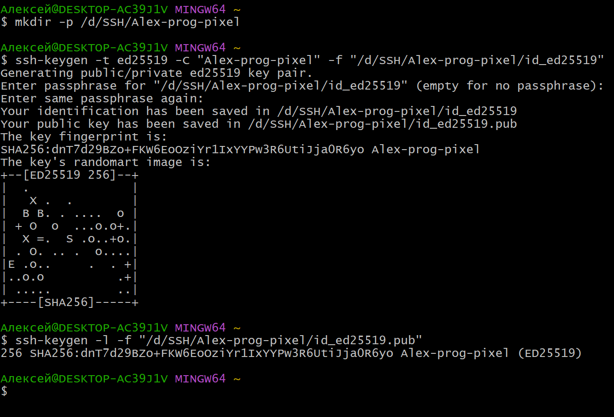
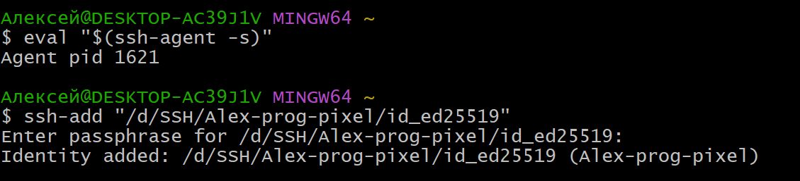
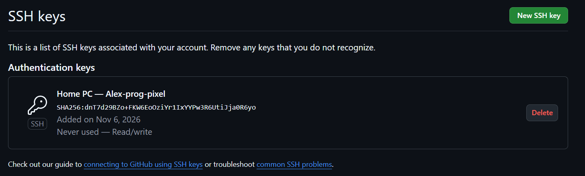
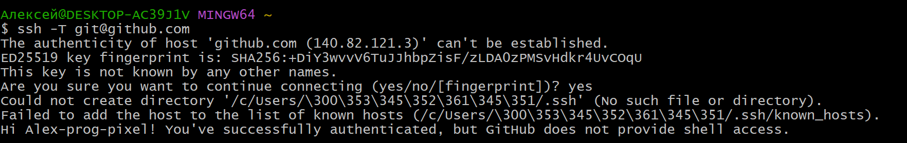
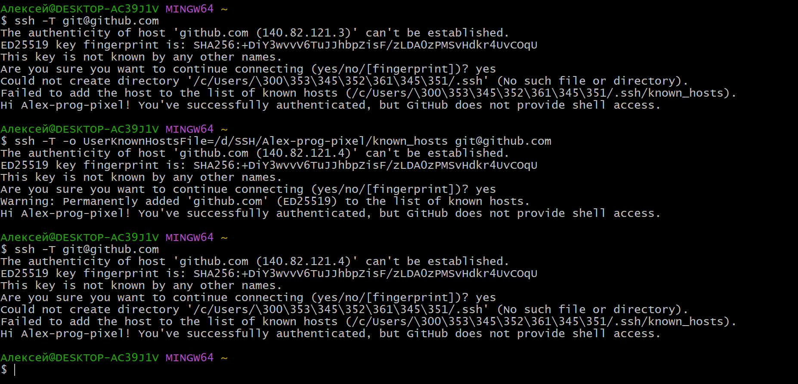
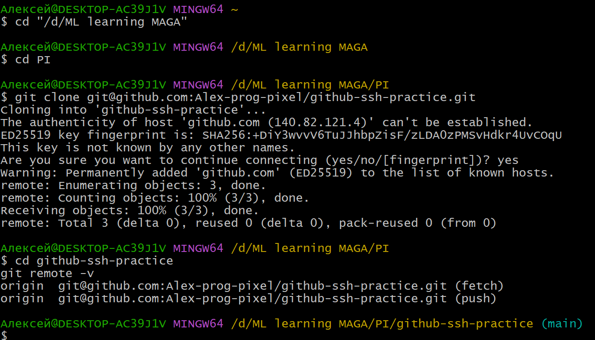

# Настройка SSH-доступа к GitHub

**Автор:** [Alex-prog-pixel](https://github.com/Alex-prog-pixel)  
**Репозиторий:** [github-ssh-practice](https://github.com/Alex-prog-pixel/github-ssh-practice)  

## Цель работы

Настроить аутентификацию на GitHub с помощью SSH-ключа Ed25519, защитить приватный ключ парольной фразой, проверить подключение и выполнить клонирование, коммит и отправку изменений по SSH.

## Окружение

- Операционная система: Windows.
- Терминал для практической части: Git Bash.
- Установленный Git: `git version 2.54.0.windows.1`.
- В системе также установлен Windows OpenSSH: `OpenSSH_for_Windows_9.5p2, LibreSSL 3.8.2`. Эта версия проверена в PowerShell; версия SSH, поставляемого с Git Bash, отдельно не фиксировалась.
- Учётная запись GitHub: `Alex-prog-pixel`.

## 1. Проверка SSH-клиента и создание ключевой пары

Наличие Git и системного SSH-клиента проверено командами:

```powershell
git --version
ssh -V
```

### Почему выбран путь без кириллицы

При первой попытке создания ключа команда:

```bash
ssh-keygen -t ed25519 -C "Alex-prog-pixel"
```

завершилась ошибкой сохранения. В использованной конфигурации Git Bash/SSH имя профиля Windows `Алексей` в стандартном пути было обработано некорректно.

Для исключения проблемы с обработкой пути создана отдельная папка `D:\SSH\Alex-prog-pixel`. Путь к ключу явно задаётся параметром `-f` при создании и аргументом команды `ssh-add` при загрузке в агент.

### Создание ключа Ed25519

В Git Bash выполнены команды:

```bash
mkdir -p /d/SSH/Alex-prog-pixel
ssh-keygen -t ed25519 -C "Alex-prog-pixel" -f "/d/SSH/Alex-prog-pixel/id_ed25519"
```

При создании ключа задан пароль.

Созданы файлы:

- `D:\SSH\Alex-prog-pixel\id_ed25519` — приватный ключ, хранится локально и не включается в отчёт или репозиторий.
- `D:\SSH\Alex-prog-pixel\id_ed25519.pub` — публичный ключ.

Корректность публичного ключа проверена командой:

```bash
ssh-keygen -l -f "/d/SSH/Alex-prog-pixel/id_ed25519.pub"
```

Полученный результат:

```text
256 SHA256:dnT7d29BZo+FKW6EoOziYr1IxYYPw3R6UtiJja0R6yo Alex-prog-pixel (ED25519)
```



### Копия публичного ключа в стандартной папке

Для выполнения требования о сохранении публичного ключа в `~/.ssh/` его копия размещена в `C:\Users\Алексей\.ssh\id_ed25519.pub`. При обращении из Git Bash использовано короткое имя той же папки Windows — `/c/Users/CD86~1/.ssh/`:

```bash
cp -i "/d/SSH/Alex-prog-pixel/id_ed25519.pub" "/c/Users/CD86~1/.ssh/id_ed25519.pub"
```

## 2. Загрузка ключа в SSH-агент

В том же сеансе Git Bash выполнены команды:

```bash
eval "$(ssh-agent -s)"
ssh-add "/d/SSH/Alex-prog-pixel/id_ed25519"
```

Агент запущен. Команда `ssh-add` запросила парольную фразу и после её ввода вывела:

```text
Identity added: /d/SSH/Alex-prog-pixel/id_ed25519 (Alex-prog-pixel)
```

Загрузка ключа в агент позволяет выполнять последующие операции в этом сеансе без повторного ввода парольной фразы для каждой операции. Окно Git Bash сохраняется открытым для дальнейшей проверки подключения и работы с репозиторием.



## 3. Добавление публичного ключа в GitHub

Публичный ключ скопирован в буфер обмена командой:

```bash
clip.exe < "/d/SSH/Alex-prog-pixel/id_ed25519.pub"
```

В учётной записи GitHub открыт раздел **Settings → SSH and GPG keys → New SSH key**. Добавлен ключ со следующими параметрами:

- Название: `Home PC — Alex-prog-pixel`.
- Тип: `Authentication Key`.
- Отпечаток: `SHA256:dnT7d29BZo+FKW6EoOziYr1IxYYPw3R6UtiJja0R6yo`.



## 4. Проверка SSH-подключения

В том же окне Git Bash выполнена команда:

```bash
ssh -T git@github.com
```

Получен фактический ответ:

```text
Hi Alex-prog-pixel! You've successfully authenticated, but GitHub does not provide shell access.
```

Таким образом, GitHub успешно аутентифицировал учётную запись `Alex-prog-pixel` с использованием SSH-ключа. Пароль учётной записи и парольная фраза ключа при этой проверке не запрашивались: ключ был предварительно загружен в агент. Фраза об отсутствии shell-доступа является штатной частью успешного ответа GitHub.



### Предупреждение о known_hosts

В том же выводе обнаружено предупреждение:

```text
Could not create directory '/c/Users/\300\353\345\352\361\345\351/.ssh' (No such file or directory).
Failed to add the host to the list of known hosts (.../.ssh/known_hosts).
```

Аутентификация завершилась успешно, однако SSH не смог сохранить проверенный ключ сервера в стандартный файл `known_hosts` из-за обработки кириллицы в пути профиля. Перенос пользовательского ключа на диск D не изменил стандартное расположение этого отдельного файла.

Для файла известных серверов также выбран путь без кириллицы: `D:\SSH\Alex-prog-pixel\known_hosts`. Выполнена команда, которая задаёт его явно:

```bash
ssh -T -o UserKnownHostsFile=/d/SSH/Alex-prog-pixel/known_hosts git@github.com
```

После сверки отпечатка сервера и ответа `yes` получены сообщения:

```text
Warning: Permanently added 'github.com' (ED25519) to the list of known hosts.
Hi Alex-prog-pixel! You've successfully authenticated, but GitHub does not provide shell access.
```

Наличие созданного файла `D:\SSH\Alex-prog-pixel\known_hosts` дополнительно проверено локально. Отпечаток содержащегося в нём ключа сервера:

```text
256 SHA256:+DiY3wvvV6TuJJhbpZisF/zLDA0zPMSvHdkr4UvCOqU github.com (ED25519)
```

Параметр `-o UserKnownHostsFile=...` действует только на конкретный запуск SSH и сам по себе не сохраняет настройку для следующих команд. Поэтому последующий запуск короткой команды `ssh -T git@github.com` снова обратился к стандартному пути и повторил предупреждение о кириллице. Повторная проверка соединения с явно указанным файлом на этом скриншоте не показана.




## 5. Работа с репозиторием по SSH

### Создание и клонирование репозитория

На GitHub создан собственный репозиторий [Alex-prog-pixel/github-ssh-practice](https://github.com/Alex-prog-pixel/github-ssh-practice) с начальным README. Исходный коммит: `f1d8040`, сообщение `Initial commit`. Рабочая ветка: `main`.

В Git Bash выполнены команды:

```bash
cd "/d/ML learning MAGA"
cd PI
git clone git@github.com:Alex-prog-pixel/github-ssh-practice.git
cd github-ssh-practice
git remote -v
```

Локальная копия находится в `D:\ML learning MAGA\PI\github-ssh-practice`. Команда `git remote -v` показала SSH-URL для чтения и записи:

```text
origin  git@github.com:Alex-prog-pixel/github-ssh-practice.git (fetch)
origin  git@github.com:Alex-prog-pixel/github-ssh-practice.git (push)
```



### Подготовка отчёта

В рабочей папке репозитория размещены README с описанием выполненных действий, скриншоты и `.gitignore`, исключающий стандартные имена приватных SSH-ключей. Файлы ключевой пары находятся вне репозитория.


## Состав отчёта и безопасность

В папке отчёта находятся README, `.gitignore` и скриншоты. Приватный ключ, парольная фраза и пароль GitHub сюда не копируются. На скриншотах показаны команды, публичный отпечаток и подтверждения выполненных действий; содержимое приватного ключа и секреты отсутствуют.
